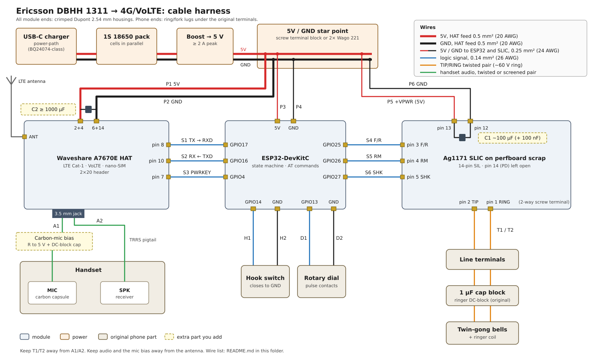

# Cable harness (alternative to the carrier board)

Same netlist as [`../carrier-board/`](../carrier-board/), built as loose wires instead of a
PCB, so the three modules can sit wherever there is room in the bakelite case. The carrier
board stays in the repo as the rigid alternative.

What the harness removes: the 44 × 100 mm fit question, the ESP32 row-spacing caveat
(25.4 vs 22.86 mm), and the PWRKEY jumper (it is just another wire now).
What it adds: you have to place the two capacitors and the power star point yourself.



(`harness.svg` is the editable source; re-render with `rsvg-convert -o harness.png harness.svg`.)

## Layout: three modules, one star point

```
                      ┌────────────── 5V/GND star point ──────────────┐
 boost 5V out ────────┤  (screw terminal or Wago, C2 1000 µF here     │
                      │   or at the HAT end of the P1/P2 pair)        │
                      └──┬───────────────┬───────────────────┬────────┘
                   P1/P2 │         P3/P4 │             P5/P6 │
                   thick │               │                   │
                 ┌───────┴──────┐  ┌─────┴──────┐  ┌─────────┴────────┐
                 │ A7670E HAT   │  │  ESP32     │  │ Ag1171 on a small│
                 │              ├──┤  DevKitC   ├──┤ perfboard + C1   │
                 └──────┬───────┘S1│            │S4└─────────┬────────┘
                   3.5 mm jack  -S3└──┬─────┬───┘-S6         │ T1/T2 twisted
                        │             │     │                │
                    MIC / SPK       HOOK   DIAL         line terminals
                    (handset)                           (bells via 1MF block)
```

Feed every module from the star point with its own 5V + GND pair. Do not daisy-chain the
ESP32 or the SLIC off the HAT's power pins: the modem's TX bursts would then show up on
their supply.

## Wire list

### Power (from the star point)

| # | From | To | Wire | Notes |
|---|------|----|------|-------|
| P1 | 5V | HAT pin 2 **and** pin 4 | 0.5 mm² (20 AWG), red | 1–2 A bursts. Two pins share the current. |
| P2 | GND | HAT pin 6 **and** pin 14 | 0.5 mm² (20 AWG), black | Keep P1/P2 short and run them together. |
| P3 | 5V | ESP32 5V (VIN) | 0.25 mm² (24 AWG), red | |
| P4 | GND | ESP32 GND | 0.25 mm² (24 AWG), black | Also the signal ground for the UART. |
| P5 | +VPWR | Ag1171 pin 13 | 0.25 mm² (24 AWG), red | 3.3–5 V per your Ag1171 variant. |
| P6 | GND | Ag1171 pin 12 (GNDPWR) | 0.25 mm² (24 AWG), black | |

- **C2 (≥1000 µF)** across 5V/GND, as close to the HAT as you can get it.
- **C1 (~100 µF, plus 100 nF if handy)** directly across Ag1171 pins 13/12, leads as short
  as possible. This is why the SLIC should sit on a scrap of perfboard: C1, the SIL pins
  and a 2-way screw terminal for TIP/RING all get a solid home.

### Signals (thin wire, 0.14 mm² / 26 AWG is plenty)

| # | ESP32 | To | Function |
|---|-------|----|----------|
| S1 | GPIO17 (TX) | HAT pin 8 | → modem RXD |
| S2 | GPIO16 (RX) | HAT pin 10 | ← modem TXD |
| S3 | GPIO4 | HAT pin 7 | PWRKEY |
| S4 | GPIO25 | Ag1171 pin 3 | F/R |
| S5 | GPIO26 | Ag1171 pin 4 | RM |
| S6 | GPIO27 | Ag1171 pin 5 | SHK |

Ag1171 pin 14 (PD) stays open, as on the carrier board.

### Phone side

| # | From | To | Wire | Notes |
|---|------|----|------|-------|
| T1 | Ag1171 pin 2 (TIP) | line terminal | twisted pair with T2 | Carries the ~60 V ring. |
| T2 | Ag1171 pin 1 (RING) | line terminal | twisted pair with T1 | Bells stay behind the phone's own 1MF cap. |
| H1 | ESP32 GPIO14 | hook switch contact | pair with H2 | Internal pull-up. |
| H2 | ESP32 GND | hook switch contact | | |
| D1 | ESP32 GPIO13 | dial pulse contact | pair with D2 | Internal pull-up. |
| D2 | ESP32 GND | dial pulse contact | | |
| A1 | HAT 3.5 mm jack (TRRS pigtail), mic + ground | handset MIC | twisted or screened pair | Carbon-mic bias still needed, see carrier-board README. |
| A2 | HAT 3.5 mm jack (TRRS pigtail), earpiece + ground | handset SPK | twisted pair | |

## Connectors

- **Module ends:** crimped Dupont (2.54 mm) housings so every module unplugs. For P1/P2 on
  the HAT use a 2×2 housing over pins 2/4/6 (plus a single for 14), or solder; a single
  Dupont contact is marginal for 2 A bursts.
- **Phone ends:** small ring or fork lugs under the original screw/leaf-spring terminals.
  Nothing is cut or soldered inside the phone, so it stays reversible.
- **Star point:** a 2-pole screw terminal block or two Wago 221 lever connectors.

## Routing rules

- Keep the T1/T2 ring pair away from the audio pairs (A1/A2) and do not bundle them
  together; cross at right angles where they must meet.
- Keep the audio pairs and the mic bias parts away from the LTE antenna and its cable.
- Bundle S1–S3 as one loom (ESP32 ↔ HAT) and S4–S6 as another (ESP32 ↔ SLIC).
- Hook and dial wires can be long; if the dial pulses look noisy on the scope, add 100 nF
  from GPIO13 to GND at the ESP32.
- Lace or sleeve the looms and tie them to existing screws. No adhesive on the bakelite.

## Before cutting wire

1. Dry-fit the three modules, the battery pack, the boost and the charger in the case and
   decide where each one sits. Mark the antenna position.
2. Measure each run with a piece of string along the real route and add ~3 cm of slack.
3. Build and test the harness on the bench first (Dupont jumpers are fine), then cut the
   final lengths.
